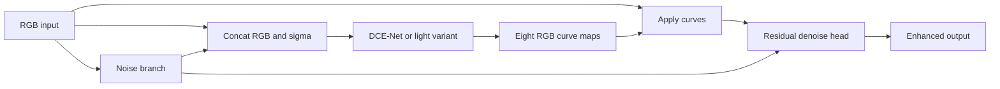

# Architecture

## Web/backend boundary

The repository separates the empty [Next.js demo](../../web/README.md) in web/
from the Python CV/backend workspace in core/. This document describes the core.
Web owns browser presentation; core owns models, training and inference. A future
HTTP serving adapter can call these public interfaces, but no web/API integration
or serving framework is implemented yet. Models and tensor losses do not depend
on Next.js or request handling.

## Scope and overview

M0 defines a clean-room baseline from [R1](REFERENCES.md#r1), informed by the
reference profile [R2](REFERENCES.md#r2), plus five proposed extensions. Tensor
contracts are normative in [INTERFACES](INTERFACES.md); equations and reduction
choices are normative in [METHOD](METHOD.md). There are no algorithms yet.

```text
RGB x [B,3,H,W] ---------------------------------------------+
   |                                                        |
   +--> NoiseBranch --> sigma [B,1,H,W]                      |
   |                     |                                  |
   +--> concat(x,sigma) --+--> DCE-Net --> A [B,24,H,W]       |
                                  |                         |
                                  +--> apply_curves(x,A) <---+
                                            |
                                       enhanced_raw
                                            |
                                  optional residual denoiser
                                  conditioned on sigma*gain
                                            |
                                         enhanced
```



With noise disabled, DCE-Net consumes three channels and sigma is zero; with
denoise disabled, output equals enhanced_raw. The diagram shows the enabled
path; disabled modules are bypassed. A_override permits reapplying temporally
smoothed curves. No flow or state enters a still-image model forward.

## Training graph

```text
unpaired RGB x -> optional synthetic x+n -> E -> {enhanced, raw, A, sigma}
                       |                           |     |    |    |
                       +-> spa(input,enhanced) <----+     |    |    |
enhanced -> exp OR adaptive_exp(targets(input,sigma_detached))  |    |
enhanced -> col; A -> tv --------------------------------------+    |
input,enhanced,sigma_detached,gain_detached -> edge/chroma/highlight |
known a,b,clean x -> sigma_target -> noise(sigma,target) <----------+
no_grad E(x) -> teacher enhanced -> invariance(noisy enhanced,teacher)
            -> teacher raw      -> fidelity(noisy enhanced,teacher raw)
real or synthetic pair -> E(frame1),E(frame2) -> temporal
pair -> bidirectional DIS or analytic flow -> reliable mask -> temporal
all gated scalar losses -> weighted sum -> backward -> clip -> Adam step
```

| Loss | Tensor inputs | Gate | Gradient destination |
| --- | --- | --- | --- |
| spa | input, enhanced | always | enhanced |
| exp | enhanced | not adaptive_exp | enhanced |
| adaptive_exp | enhanced, detached targets | adaptive_exp | enhanced |
| col | enhanced | always | enhanced |
| tv | A | always | curve estimator |
| edge | input, enhanced, detached sigma/gain | edge | enhanced |
| chroma | input, enhanced, detached sigma | chroma | enhanced |
| highlight | input, enhanced | adaptive_exp | enhanced |
| noise | sigma, detached synthetic target | noise_aware | noise head |
| invariance | noisy enhanced, detached teacher enhanced | noise_aware | noisy student |
| fidelity | noisy enhanced, detached teacher raw | denoise | student including denoiser |
| temporal | previous/current enhanced, backward flow, mask | temporal | both frame forwards |

Synthetic corruption supervises sigma without high-light labels. The clean-input
teacher is the same model under no_grad, not an EMA teacher. It is not a claim
that already noisy SICE images are physically clean. See METHOD for that caveat.

## Inference graph

```text
current RGB -> resized estimator -> upsampled A_t, sigma_t
previous/current RGB -> CPU DIS both directions -> current-domain reliability
cut or changed size? -> clear previous RGB/A/output, use current maps
otherwise -> warp(previous smoothed A, backward current->previous flow)
          -> reliable convex curve blend -> apply curves on current full RGB
          -> optional denoise -> optional reliable output blend -> output
store detached current RGB, smoothed A, final output for next frame
```

Flow resolution affects estimation cost, never the units of the final field.
Upscale both spatial grids and displacement components. New streams cannot share
state. Unreliable pixels always use the current maps/output; no mask leaves no
historical influence. Optional output blending defaults to zero.

## Module responsibilities and dependency rules

| Module | Owns | May depend on |
| --- | --- | --- |
| models | curves, learned heads, composition | torch, model peers, schema type annotations only |
| losses | pure tensor functions | torch and differentiable flow/warp for temporal |
| data | decoded samples, synthetic noise/geometry | tensor tools, IO, flow facade for real pairs |
| flow | OpenCV DIS boundary, pure warp/masks | torch; OpenCV only in estimator |
| inference | eval-mode state and IO | model, flow, schema records |
| metrics | per-sample reporting | tensor/warp primitives; no training state |
| training | validated config, optimization, logs/checkpoints | all lower-level modules |
| utils | typed registry, seed/device | standard library, NumPy/torch as appropriate |
| scripts | argparse and orchestration | public APIs; never hidden model logic |

Models must not import datasets, trainers, loop_step, optimizer or losses. Because
the required schema lives in training/config.py, Config is a TYPE_CHECKING-only
annotation import in models; model behavior depends only on the supplied record.
Only flow/estimator may call OpenCV optical-flow APIs; decoding/capture may use
OpenCV separately. Losses do not read paths, infer flow, modify registries or move
devices. Registries are orchestration metadata, not hidden side effects of loss import.

## Flag and extension matrix

| Extension | Flag(s) | Architecture | Training | Inference |
| --- | --- | --- | --- | --- |
| Noise | noise_aware; optional denoise | sigma head, fourth channel, optional residual head | noise/invariance; fidelity if denoise | sigma-conditioned correction |
| Edge | edge | unchanged | reliable Sobel loss | no extra stage |
| Chroma | chroma | unchanged | local chroma loss | no extra stage |
| Exposure | adaptive_exp | unchanged | replaces exp; adds highlight | learned maps only |
| Temporal | temporal | stateless image model | pair loss with reliability mask | flow, curve state, reset/blend |

Edge/chroma/exposure alone use zero sigma. Disabling the noise extension in a
leave-one-out run also disables denoise. Light and curve_scale are performance
options recorded independently; compare their quality separately at M6.

## Decisions and reasons

Curve-space temporal blending preserves the current frame's pixels and bounds
under a convex blend of maps; output blending may smear details, so it is optional.
Synthetic sigma supervision gives known noise targets without requiring paired
high-light training images; it needs real-camera validation before stronger claims.
Flags and one resolved schema make ablations comparable and checkpoint architecture
explicit, instead of drifting code/config forks. Detached reliability/targets avoid
incentivizing sigma inflation to hide difficult edges or lower exposure targets.
An independent light depthwise-separable architecture is inspired by [R3](REFERENCES.md#r3)
but must not be labelled a reproduced Zero-DCE++ model.
